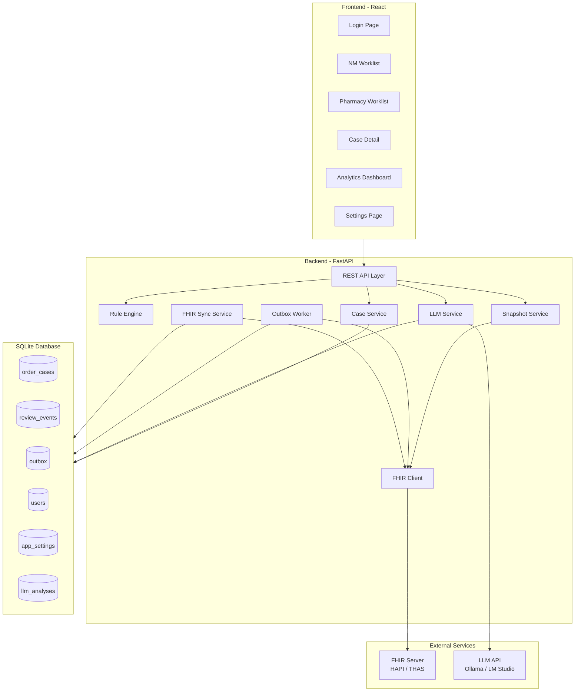
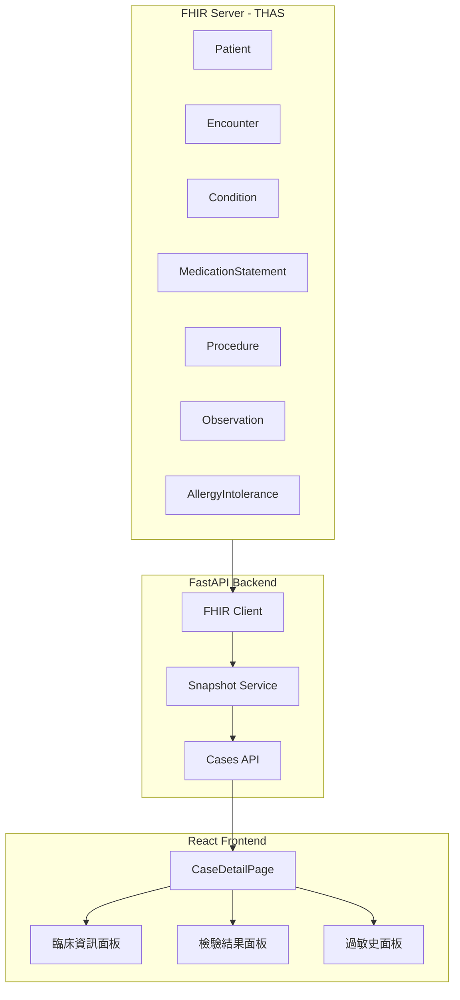
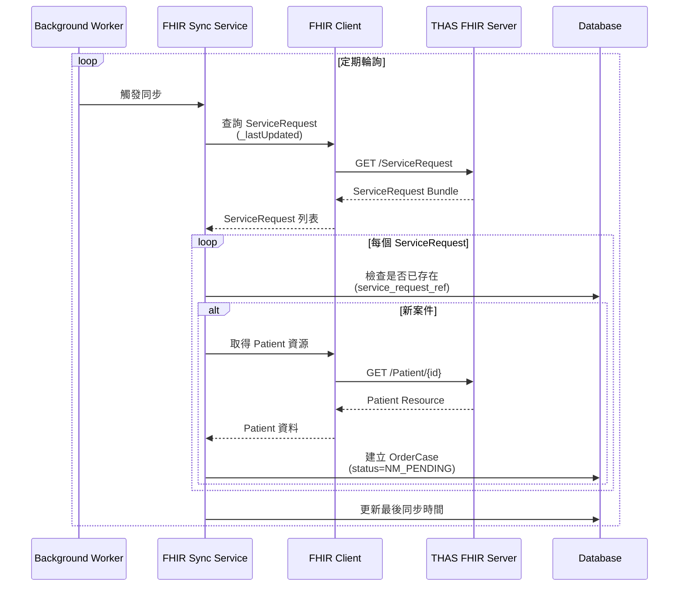
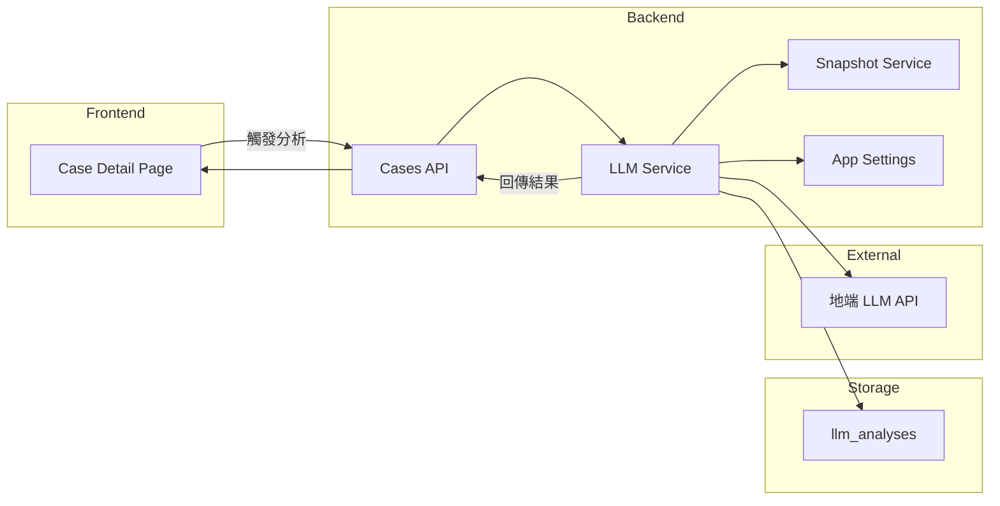
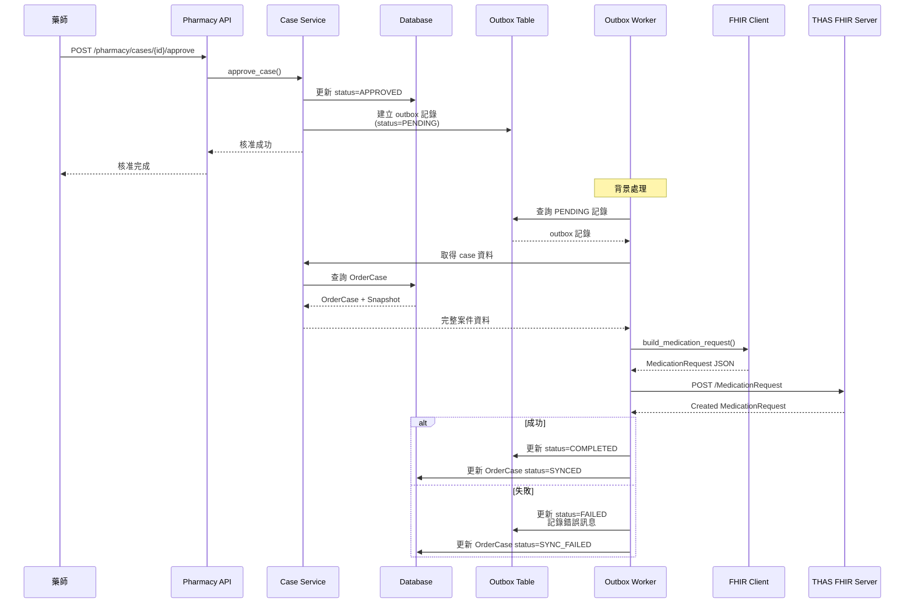
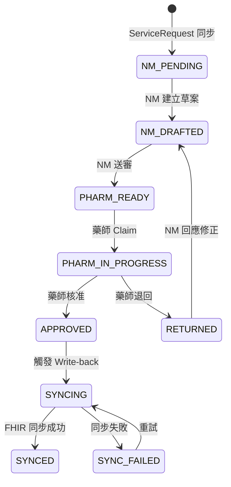

# NM SMART on FHIR 核醫放射藥物用藥治理系統 - 完整應用說明文件

## 目錄

1. [系統概述](#系統概述)
2. [功能說明](#功能說明)
3. [技術架構](#技術架構)
4. [核心工作流程](#核心工作流程)
5. [模組詳細說明](#模組詳細說明)
6. [API 端點說明](#api-端點說明)
7. [資料模型](#資料模型)
8. [部署與設定](#部署與設定)

---

## 系統概述

### 系統簡介

本系統為基於 **FHIR R4**、**TW Core** 與 **SMART on FHIR** 架構之核子醫學放射藥物用藥治理與臨床決策支援系統。系統提供完整的核醫用藥審查工作流程，包含核醫醫師用藥草案建立、藥師審核、臨床決策支援（CDS）、劑量計算、以及與 FHIR Server 的資料同步功能。

### 核心特色

- **SMART on FHIR 整合**：支援 Production Mode 與 Demo Mode，可連接 THAS 競賽環境或本地 HAPI FHIR Server
- **臨床決策支援（CDS）**：基於規則引擎的自動評估，提供劑量檢查、適應症評估、警告與建議
- **NA-2024 劑量計算**：依據 2024 北美兒童放射藥物劑量共識指引自動計算建議劑量
- **批次處理**：支援核醫醫師批次送審、藥師批次核准
- **LLM 輔助分析**：整合地端 LLM API，提供病例摘要、適應症評估與 CDSS 整合建議
- **完整臨床資訊展示**：整合病人就醫紀錄、檢驗資料、用藥史、過敏史等臨床資訊
- **分析儀表板**：提供 KPI 統計、圖表分析與 CSV 匯出功能

### 技術堆疊

**後端**
- Python 3.11+
- FastAPI
- SQLite (SQLAlchemy 2.x)
- httpx (FHIR Client)

**前端**
- React 18 + TypeScript
- Vite
- Material UI (MUI)
- React Router v6
- @tanstack/react-query

**外部整合**
- FHIR R4 Server (HAPI / THAS)
- SMART on FHIR OAuth2
- LLM API (OpenAI 相容)

---

## 功能說明

### 1. 核醫醫師工作流程

#### 1.1 工作清單管理

核醫醫師可查看以下狀態的案件：

- **待核醫處理（NM_PENDING）**：從 FHIR Server 同步的新 ServiceRequest，尚未建立草案
- **已建立草案（NM_DRAFTED）**：已建立用藥草案，但尚未送審
- **已退回（RETURNED）**：藥師退回的案件，需核醫醫師回應修正

**功能特色：**
- 分頁顯示與篩選
- 顯示 CDS 評估結果（severity badge、flags 數量）
- 批次送審功能（僅限 CDS 非 FAIL 案件）

#### 1.2 案件詳情與草案建立

在案件詳情頁面，核醫醫師可：

**病人資訊區塊：**
- 顯示病人基本資料（從 FHIR Patient 資源取得）
- ServiceRequest 資訊（檢查項目、申請醫師、期望執行時間等）

**臨床資訊展示：**
- **臨床紀錄**：就醫紀錄（Encounter）、診斷/病史（Condition）、用藥紀錄（MedicationStatement）、處置紀錄（Procedure）
- **重要檢驗資料**：腎功能、肝功能、甲狀腺功能、血液檢驗（依類別分組顯示）
- **過敏史**：藥物過敏與其他過敏反應（高亮顯示嚴重程度）

**劑量編輯與計算：**
- 顯示/編輯草案劑量（Draft Dose）
- **NA-2024 劑量計算參考**：
  - 根據病人體重自動計算建議劑量
  - 顯示計算公式與參考值
  - 顯示最小/最大劑量範圍
  - 一鍵「採用建議劑量」功能
- 支援的檢查類型：BONE_SCAN、FDG_PET、DMSA、MAG3、MIBG、DOTATATE、DTPA、NaF_PET

**CDS 評估面板：**
- 顯示 `overallSeverity`（PASS / WARN / FAIL）
- 列出所有 `flags[]`（code、title、explain、recommendation）
- FAIL 級別以紅色警示框顯示
- CDS FAIL 的案件會自動從「已建立草案」移至「待核醫處理」

**AI 輔助分析（LLM）：**
- 病例摘要：基於 FHIR snapshot 的病例摘要
- 適應症評估：評估檢查適應症是否適當
- CDSS 整合建議：整合 CDS flags 提供下一步行動建議

**Auto-fill 功能：**
- 系統自動從 FHIR 資料中提取候選值（如體重、腎功能）
- 核醫醫師可接受或拒絕候選值
- 手動輸入事實值

**操作按鈕：**
- **建立/更新草案**：儲存用藥草案（含劑量、給藥途徑等）
- **送審**：將草案提交給藥師審核
- **回應退回**：回應藥師的退回意見

#### 1.3 批次送審

在「已建立草案」Tab 中，核醫醫師可：

- 選取多個 CDS 評估為 PASS 或 WARN 的案件
- 點擊「全部送審」按鈕進行批次送審
- 系統會顯示送審結果摘要（成功/失敗數量）

**限制：**
- 僅對 `overallSeverity != FAIL` 的案件啟用批次送審
- CDS FAIL 的案件需個別處理

### 2. 藥師工作流程

#### 2.1 工作清單管理

藥師工作清單分為以下群組：

- **Pass Queue（可批次核准）**：CDS 評估為 PASS 的案件，可批次核准
- **Exceptions（需逐筆審查）**：有 FAIL flags 的案件，需個別審查
- **My Claimed（我已 Claim）**：藥師已 Claim 的案件
- **Physician Response（醫師回覆）**：有藥師退回或醫師回應的案件
- **Approved（批准待上傳）**：已核准但尚未同步到 FHIR 的案件

#### 2.2 案件審核

藥師可對案件進行以下操作：

- **Claim**：認領案件（確保同一案件只有一位藥師處理）
- **核准**：核准用藥草案，觸發 FHIR write-back
- **退回**：退回給核醫醫師，需提供退回原因

#### 2.3 批次核准

藥師可批次選取多個「Pass Queue」中的案件，進行批次核准。

### 3. 臨床決策支援（CDS）

#### 3.1 規則引擎

系統內建規則引擎，根據以下規則進行評估：

**劑量檢查規則：**
- `MISSING_WEIGHT`：缺少體重資料
- `DOSE_OUT_OF_RANGE`：劑量超出建議範圍
- `EXAM_DRUG_MISMATCH`：檢查項目與藥物不匹配

**臨床檢查規則：**
- `RENAL_FUNCTION_ABNORMAL`：腎功能異常
- `LIVER_FUNCTION_ABNORMAL`：肝功能異常
- `ALLERGY_WARNING`：過敏警告

**評估結果：**
- `overallSeverity`：PASS / WARN / FAIL
- `flags[]`：詳細的警告與建議清單
- `isBatchEligible`：是否可批次處理

#### 3.2 NA-2024 劑量計算

系統整合 **2024 北美兒童放射藥物劑量共識指引（NA-2024）**，提供：

- 依體重自動計算建議劑量（MBq/kg）
- 區分兒童（<70kg）與成人劑量計算
- 顯示最小/最大劑量範圍
- 一鍵採用建議劑量

**支援的檢查類型與劑量係數：**

| 檢查 | 放射藥物 | 劑量係數 (MBq/kg) | 最小劑量 (MBq) | 最大劑量 (MBq) |
|------|----------|-------------------|----------------|----------------|
| BONE_SCAN | Tc-99m MDP | 9.3 | 37 | 740 |
| FDG_PET | F-18 FDG | 2.96-5.2 | 37 | 370 |
| DMSA | Tc-99m DMSA | 1.85 | 18.5 | 185 |
| MAG3 | Tc-99m MAG3 | 3.7 | 37 | 370 |
| MIBG | I-123 MIBG | 5.2 | 37 | 370 |
| DOTATATE | Ga-68 DOTATATE | 2.0 | 37 | 185 |
| DTPA | Tc-99m DTPA | 3.7 | 37 | 370 |
| NaF_PET | F-18 NaF | 2.96 | 37 | 370 |

### 4. LLM 輔助分析

#### 4.1 功能說明

系統整合地端 LLM API（支援 Ollama、LM Studio、vLLM 等 OpenAI 相容 API），提供：

- **病例摘要**：基於 FHIR snapshot 的病例摘要
- **適應症評估**：評估檢查適應症是否適當
- **CDSS 整合建議**：整合 CDS flags 提供下一步行動建議

#### 4.2 設定管理

管理員可在「設定」頁面配置：

- LLM API endpoint URL
- Model Name
- API Key（可選）
- System Prompt（系統提示詞）
- User Prompt Template（使用者提示詞模板，含變數說明）
- 自動分析開關

#### 4.3 使用方式

- **手動觸發**：在案件詳情頁點擊「AI 分析」按鈕
- **自動觸發**：若啟用自動分析，系統會在案件建立時自動觸發分析
- **分析結果**：顯示病例摘要、適應症評估、CDSS 整合建議、信心度與限制

### 5. ServiceRequest 同步

#### 5.1 同步機制

系統支援從 THAS FHIR Server 同步核醫相關的 ServiceRequest：

- **手動觸發**：核醫醫師可透過「同步工作清單」按鈕手動觸發
- **背景輪詢**：系統會定期（可設定間隔）查詢 FHIR Server 的新 ServiceRequest
- **過濾條件**：根據 `category` 或 `code` 識別核醫檢查
- **避免重複**：透過 `service_request_ref` 檢查，避免重複建立案件

#### 5.2 同步資料

從 ServiceRequest 提取的資料包含：

- 基本資訊：檢查項目、申請醫師（requester）、期望執行時間（occurrenceDateTime）
- 適應症：reasonCode/reasonReference（診斷依據）
- 病人參考：Patient 資源參考

### 6. 分析儀表板

#### 6.1 KPI 統計

提供以下 KPI 指標：

- **介入率**：藥師退回案件比例
- **不當劑量率**：劑量超出範圍的案件比例
- **平均處理時間（TAT）**：從建立到核准的平均時間
- **Auto-fill 接受率**：自動填入候選值的接受率

#### 6.2 圖表分析

- 退回原因分佈圖
- 處理時間分佈圖
- 案件狀態分佈圖

#### 6.3 CSV 匯出

可匯出選定日期內已審查完成的藥單清單，包含：

- 病患姓名、病患ID
- 檢查名稱
- 劑量、使用時間（occurrenceDateTime）
- 建立醫師、審查藥師
- 批准日期

### 7. 使用者管理（Production Mode）

#### 7.1 SMART on FHIR 登入

在 Production Mode 下，系統支援 SMART on FHIR 授權流程：

1. 使用者點擊「透過 THAS 登入」按鈕
2. 重導向到 THAS 授權頁面
3. 使用者登入並授權
4. THAS 回傳 authorization code
5. 後端用 code 換取 access_token 和 id_token
6. 解析 id_token 取得 Practitioner 身份
7. 查詢/建立本地 User 記錄

#### 7.2 使用者狀態管理

使用者狀態流程：

```
首次 SMART 登入 → PENDING（待審核）
    ↓
管理員審核通過 + 指派角色 → ACTIVE（已啟用）
    ↓
管理員停用 → INACTIVE（已停用）
```

#### 7.3 角色管理

管理員可：

- 查看使用者列表（含篩選 status）
- 審核待審核使用者（指派角色：NM_PHYSICIAN、PHARMACIST、ADMIN）
- 更新使用者角色
- 啟用/停用使用者

---

## 技術架構

### 系統架構圖



### 資料流程架構

#### 臨床資訊展示流程



#### ServiceRequest 同步流程



#### LLM 分析流程



#### MedicationRequest Write-back 流程



---

## 核心工作流程

### 案件狀態機



### 狀態說明

| 狀態 | 說明 | 可執行動作 |
|------|------|------------|
| NM_PENDING | 待核醫處理 | 建立草案 |
| NM_DRAFTED | 已建立草案 | 送審、更新草案 |
| PHARM_READY | 待藥師審核 | 藥師 Claim |
| PHARM_IN_PROGRESS | 藥師審核中 | 核准、退回 |
| RETURNED | 已退回 | 回應修正 |
| APPROVED | 已核准 | 觸發 write-back |
| SYNCING | 同步中 | 等待完成 |
| SYNCED | 已同步 | 完成 |
| SYNC_FAILED | 同步失敗 | 重試 |

### CDS FAIL 處理邏輯

當案件狀態為 `NM_DRAFTED` 且 `overallSeverity == FAIL` 時：

- 案件會自動從「已建立草案」移至「待核醫處理」
- 無法進行批次送審
- 需核醫醫師個別處理，修正問題後才能送審

---

## 模組詳細說明

### 1. Backend 模組

#### 1.1 API 路由模組 (`backend/app/api/`)

**nm.py** - 核醫醫師 API
- `GET /api/nm/worklist` - 取得工作清單
- `POST /api/nm/cases/{id}/draft` - 建立/更新草案
- `POST /api/nm/cases/{id}/submit` - 送審
- `POST /api/nm/cases/{id}/respond` - 回應退回
- `POST /api/nm/bulk-submit` - 批次送審
- `POST /api/nm/sync-worklist` - 同步工作清單

**pharmacy.py** - 藥師 API
- `GET /api/pharmacy/worklist` - 取得工作清單
- `POST /api/pharmacy/cases/{id}/claim` - Claim 案件
- `POST /api/pharmacy/cases/{id}/approve` - 核准
- `POST /api/pharmacy/cases/{id}/return` - 退回
- `POST /api/pharmacy/bulk-approve` - 批次核准

**cases.py** - 案件 API
- `GET /api/cases/{id}/snapshot` - 取得病人快照
- `POST /api/cases/{id}/autofill/accept` - 接受自動填入
- `POST /api/cases/{id}/autofill/reject` - 拒絕自動填入
- `POST /api/cases/{id}/refresh-clinical-data` - 重新整理臨床資料
- `POST /api/cases/{id}/llm-analysis` - 觸發 LLM 分析
- `GET /api/cases/{id}/llm-analysis` - 取得 LLM 分析結果

**analytics.py** - 分析 API
- `GET /api/analytics/summary` - KPI 摘要
- `GET /api/analytics/autofill/summary` - Auto-fill 統計
- `GET /api/analytics/export/csv` - CSV 匯出
- `GET /api/analytics/sync-logs` - 同步記錄

**auth.py** - 認證 API
- `GET /api/auth/smart/launch` - SMART 授權啟動
- `POST /api/auth/smart/callback` - SMART 回呼處理
- `GET /api/auth/user-info` - 取得使用者資訊

**admin.py** - 管理員 API
- `GET /api/admin/users` - 使用者列表
- `GET /api/admin/users/pending` - 待審核使用者
- `POST /api/admin/users/{id}/approve` - 審核使用者
- `PUT /api/admin/users/{id}` - 更新使用者
- `POST /api/admin/users/{id}/deactivate` - 停用使用者

**settings.py** - 設定 API
- `GET /api/settings/llm` - 取得 LLM 設定
- `PUT /api/settings/llm` - 更新 LLM 設定
- `POST /api/settings/llm/test` - 測試 LLM 連線
- `GET /api/settings/llm/default-prompts` - 取得預設提示詞

**demo.py** - Demo Mode API
- `GET /api/demo/whoami` - 當前身份
- `POST /api/demo/set-acting-role` - 切換角色
- `POST /api/demo/seed` - 建立示範資料

#### 1.2 服務模組 (`backend/app/services/`)

**case_service.py** - 案件服務
- 工作清單查詢與分群
- 案件狀態轉換
- Claim/Approve/Return 邏輯
- 批次操作處理

**snapshot_service.py** - 快照服務
- 從 FHIR Server 取得病人資料
- 建立與更新 snapshot
- 臨床資料擷取與分類
- Auto-fill 候選值提取

**fhir_sync_service.py** - FHIR 同步服務
- 從 FHIR Server 查詢 ServiceRequest
- 轉換 ServiceRequest 為 OrderCase
- 提取 occurrenceDateTime、requester、reasonCode 等欄位
- 避免重複建立案件

**llm_service.py** - LLM 服務
- 呼叫 OpenAI 相容 API
- 組合 snapshot + ruleEval 為 input payload
- 解析 LLM JSON 回應並驗證 schema
- 儲存分析結果

**outbox_worker.py** - Outbox Worker
- 監控 outbox 表
- 執行 MedicationRequest POST 到 FHIR Server
- 重試機制與錯誤處理

**analytics_service.py** - 分析服務
- KPI 計算
- Auto-fill 統計
- CSV 匯出
- 同步記錄查詢

**auth_service.py** - 認證服務
- SMART on FHIR 授權處理
- Token 交換與驗證
- 使用者身份管理

**smart_auth_service.py** - SMART 認證服務
- OAuth2 授權流程
- id_token 解析
- Practitioner 資源查詢

#### 1.3 規則引擎 (`backend/app/rules/`)

**engine.py** - 規則引擎核心
- `evaluate()` - 執行規則評估
- `calculate_na2024_dose()` - NA-2024 劑量計算
- 規則 flags 產生
- severity 判定

**config.py** - 規則設定
- 從 `rules_config.yaml` 讀取規則
- `get_route()` - 取得給藥途徑設定
- 劑量參數管理

#### 1.4 FHIR Client (`backend/app/fhir/`)

**client.py** - FHIR Client
- 支援 Local HAPI 與 THAS 切換
- GET: ServiceRequest、Patient、Observation、Encounter、Condition、MedicationStatement、Procedure、AllergyIntolerance
- POST: MedicationRequest
- `build_medication_request()` - 建立 MedicationRequest 資源
- 處理 occurrenceDateTime、route、dosageInstruction 等欄位

#### 1.5 資料模型 (`backend/app/models/`)

**order_case.py** - 案件模型
- OrderCase 表結構
- status 列舉
- snapshot_json、local_facts_json、draft_json 欄位

**review_event.py** - 審查事件模型
- ReviewEvent 表結構
- 稽核時間軸記錄

**outbox.py** - Outbox 模型
- Outbox 表結構
- 延遲 write-back 機制

**user.py** - 使用者模型
- User 表結構
- status 列舉（PENDING、ACTIVE、INACTIVE）
- allowed_roles JSON 欄位

**settings.py** - 設定模型
- AppSettings 表結構
- key-value 格式儲存

**llm_analysis.py** - LLM 分析模型
- LLMAnalysis 表結構
- 分析結果儲存

### 2. Frontend 模組

#### 2.1 頁面元件 (`frontend/src/pages/`)

**LoginPage.tsx** - 登入頁面
- Demo Mode：直接輸入 subject 和選擇角色
- Production Mode：SMART on FHIR 登入按鈕
- 角色選擇器（多角色支援）

**NMWorklistPage.tsx** - 核醫工作清單
- 分頁顯示（NM_PENDING、NM_DRAFTED、RETURNED）
- 顯示 severity badge、flags count
- 批次送審功能
- 點擊導向 Case Detail

**PharmacyWorklistPage.tsx** - 藥師工作清單
- 三區塊：Pass Queue、Exceptions、My Claimed
- 批次選取 + bulk-approve 按鈕
- 顯示操作結果摘要

**CaseDetailPage.tsx** - 案件詳情頁
- 病人資訊區塊
- 臨床資訊展示（臨床紀錄、檢驗資料、過敏史）
- 劑量編輯與 NA-2024 計算參考
- CDS 評估面板
- AI 輔助分析面板
- Auto-fill 候選值 accept/reject
- NM/Pharmacy 操作按鈕（依角色）
- 稽核時間軸

**AnalyticsPage.tsx** - 分析儀表板
- 日期範圍選擇
- KPI 卡片（介入率、不當劑量率）
- 圖表（退回原因分佈、TAT）
- CSV 下載

**SettingsPage.tsx** - 設定頁面
- LLM API 設定表單
- Endpoint URL、Model Name、API Key
- System Prompt、User Prompt Template
- 自動分析開關
- 連線測試按鈕

**UserManagementPage.tsx** - 使用者管理頁面
- 待審核使用者列表
- 審核對話框（顯示 Practitioner 資訊 + 角色選擇）
- 使用者列表（編輯角色、啟用/停用）

**SyncLogPage.tsx** - 同步記錄頁面
- FHIR 同步記錄列表
- 顯示同步時間、狀態、錯誤訊息

**AuthCallbackPage.tsx** - 認證回呼頁面
- 處理 THAS 回傳的 authorization code
- 呼叫後端 `/auth/smart/callback`
- 根據回應處理登入狀態

#### 2.2 共用元件 (`frontend/src/components/`)

**AppShell.tsx** - 應用程式外殼
- 側邊選單（依角色顯示）
- 頂部導覽列
- 路由保護

**ProtectedRoute.tsx** - 路由保護
- 檢查使用者認證狀態
- 檢查角色權限

#### 2.3 Context (`frontend/src/contexts/`)

**AuthContext.tsx** - 認證 Context
- 使用者身份管理
- X-Subject、X-Acting-Role headers 注入
- 登入/登出狀態

#### 2.4 API Client (`frontend/src/api/`)

**client.ts** - API Client
- 使用 fetch 或 axios
- 自動注入認證 headers
- 錯誤處理

#### 2.5 型別定義 (`frontend/src/types/`)

**index.ts** - TypeScript 型別
- OrderCase、PatientSnapshot、RuleEval
- DoseCalculation、LLMAnalysisResult
- WorklistResponse、BulkSubmitResponse 等

---

## API 端點說明

### 核醫醫師端點

#### GET /api/nm/worklist

取得核醫醫師工作清單。

**查詢參數：**
- `status` (optional): 篩選狀態（NM_PENDING、NM_DRAFTED、RETURNED）

**回應：**
```json
{
  "nmPending": [...],
  "nmDrafted": [...],
  "returned": [...]
}
```

#### POST /api/nm/cases/{id}/draft

建立或更新用藥草案。

**請求體：**
```json
{
  "dose": {
    "value": 370,
    "unit": "MBq"
  },
  "route": {...},
  "localFacts": {...}
}
```

#### POST /api/nm/cases/{id}/submit

送審案件。

#### POST /api/nm/cases/{id}/respond

回應藥師退回。

**請求體：**
```json
{
  "response": "已修正劑量為 370 MBq"
}
```

#### POST /api/nm/bulk-submit

批次送審。

**請求體：**
```json
{
  "caseIds": ["case-1", "case-2", ...]
}
```

**回應：**
```json
{
  "successCount": 5,
  "failureCount": 1,
  "failures": [...]
}
```

#### POST /api/nm/sync-worklist

手動觸發 ServiceRequest 同步。

### 藥師端點

#### GET /api/pharmacy/worklist

取得藥師工作清單。

**回應：**
```json
{
  "physicianResponse": [...],
  "exceptions": [...],
  "batchEligible": [...],
  "approved": [...],
  "myClaimed": [...]
}
```

#### POST /api/pharmacy/cases/{id}/claim

Claim 案件。

#### POST /api/pharmacy/cases/{id}/approve

核准案件。

**請求體：**
```json
{
  "comment": "核准通過"
}
```

#### POST /api/pharmacy/cases/{id}/return

退回案件。

**請求體：**
```json
{
  "reason": "劑量超出建議範圍",
  "suggestions": "建議調整為 370 MBq"
}
```

#### POST /api/pharmacy/bulk-approve

批次核准。

**請求體：**
```json
{
  "caseIds": ["case-1", "case-2", ...]
}
```

### 案件端點

#### GET /api/cases/{id}/snapshot

取得病人快照。

**回應：**
```json
{
  "patient": {...},
  "serviceRequest": {...},
  "clinicalData": {
    "encounters": [...],
    "medications": [...],
    "procedures": [...],
    "labResults": {...},
    "allergies": [...]
  },
  "draftDose": {...},
  "doseCalculation": {...},
  "ruleEval": {...},
  "candidateFacts": [...]
}
```

#### POST /api/cases/{id}/autofill/accept

接受自動填入候選值。

**請求體：**
```json
{
  "factKey": "weight",
  "value": 70
}
```

#### POST /api/cases/{id}/autofill/reject

拒絕自動填入候選值。

**請求體：**
```json
{
  "factKey": "weight"
}
```

#### POST /api/cases/{id}/refresh-clinical-data

重新整理臨床資料（從 FHIR Server 重新取得）。

#### POST /api/cases/{id}/llm-analysis

觸發 LLM 分析。

**請求體：**
```json
{
  "trigger_type": "MANUAL"
}
```

**回應：**
```json
{
  "id": "analysis-123",
  "caseId": "case-456",
  "status": "COMPLETED",
  "result": {
    "caseSummary": "...",
    "examDecision": "...",
    "cdssIntegration": "...",
    "quality": {...}
  },
  "latencyMs": 1234,
  "createdAt": "2024-12-25T10:00:00Z"
}
```

#### GET /api/cases/{id}/llm-analysis

取得最近的 LLM 分析結果。

### 分析端點

#### GET /api/analytics/summary

取得 KPI 摘要。

**查詢參數：**
- `from` (required): 起始日期
- `to` (required): 結束日期

**回應：**
```json
{
  "interventionRate": 0.15,
  "inappropriateDoseRate": 0.08,
  "averageTAT": 2.5,
  "autofillAcceptanceRate": 0.85
}
```

#### GET /api/analytics/export/csv

匯出 CSV。

**查詢參數：**
- `from` (required): 起始日期
- `to` (required): 結束日期

**回應：** CSV 檔案

#### GET /api/analytics/sync-logs

取得同步記錄。

**查詢參數：**
- `page` (optional): 頁碼
- `page_size` (optional): 每頁筆數

### 認證端點

#### GET /api/auth/smart/launch

產生 SMART 授權 URL，重導向到 THAS。

#### POST /api/auth/smart/callback

處理 THAS 回呼。

**請求體：**
```json
{
  "code": "authorization_code",
  "state": "state_value"
}
```

#### GET /api/auth/user-info

取得使用者資訊（供登入頁面使用）。

### 管理員端點

#### GET /api/admin/users

取得使用者列表。

**查詢參數：**
- `status` (optional): 篩選狀態
- `search` (optional): 搜尋關鍵字

#### GET /api/admin/users/pending

取得待審核使用者列表。

#### POST /api/admin/users/{id}/approve

審核使用者。

**請求體：**
```json
{
  "allowedRoles": ["NM_PHYSICIAN", "PHARMACIST"]
}
```

#### PUT /api/admin/users/{id}

更新使用者。

**請求體：**
```json
{
  "allowedRoles": ["NM_PHYSICIAN"],
  "status": "ACTIVE"
}
```

#### POST /api/admin/users/{id}/deactivate

停用使用者。

### 設定端點

#### GET /api/settings/llm

取得 LLM 設定（僅管理員）。

#### PUT /api/settings/llm

更新 LLM 設定（僅管理員）。

**請求體：**
```json
{
  "endpoint_url": "http://localhost:11434/v1",
  "model_name": "llama3",
  "api_key": "...",
  "system_prompt": "...",
  "user_prompt_template": "...",
  "auto_analyze": true,
  "disable_thinking_mode": false
}
```

#### POST /api/settings/llm/test

測試 LLM 連線。

#### GET /api/settings/llm/default-prompts

取得預設提示詞。

### Demo Mode 端點

#### GET /api/demo/whoami

取得當前身份。

#### POST /api/demo/set-acting-role

切換角色。

**請求體：**
```json
{
  "actingRole": "NM_PHYSICIAN"
}
```

#### POST /api/demo/seed

建立示範資料。

---

## 資料模型

### OrderCase（案件）

| 欄位 | 類型 | 說明 |
|------|------|------|
| id | UUID | 案件 ID |
| service_request_ref | String | FHIR ServiceRequest 參考 |
| patient_ref | String | FHIR Patient 參考 |
| status | Enum | 案件狀態 |
| snapshot_json | JSON | 病人快照（含臨床資料） |
| local_facts_json | JSON | 本地事實值 |
| draft_json | JSON | 用藥草案 |
| owner | String | 當前處理者（藥師 Claim 時） |
| created_at | DateTime | 建立時間 |
| updated_at | DateTime | 更新時間 |

### ReviewEvent（審查事件）

| 欄位 | 類型 | 說明 |
|------|------|------|
| id | UUID | 事件 ID |
| case_id | UUID | 案件 ID |
| event_type | Enum | 事件類型（DRAFT、SUBMIT、CLAIM、APPROVE、RETURN 等） |
| actor | String | 執行者 |
| comment | String | 備註 |
| created_at | DateTime | 建立時間 |

### Outbox（待同步）

| 欄位 | 類型 | 說明 |
|------|------|------|
| id | UUID | Outbox ID |
| case_id | UUID | 案件 ID |
| payload_json | JSON | MedicationRequest 資源 |
| status | Enum | 狀態（PENDING、COMPLETED、FAILED） |
| error_message | String | 錯誤訊息 |
| retry_count | Integer | 重試次數 |
| created_at | DateTime | 建立時間 |
| updated_at | DateTime | 更新時間 |

### User（使用者）

| 欄位 | 類型 | 說明 |
|------|------|------|
| id | UUID | 使用者 ID |
| subject | String | SMART sub 或員工編號（UNIQUE） |
| practitioner_ref | String | FHIR Practitioner 參考 |
| display_name | String | 顯示名稱 |
| allowed_roles | JSON | 允許的角色列表 |
| status | Enum | 狀態（PENDING、ACTIVE、INACTIVE） |
| last_login_at | DateTime | 最後登入時間 |
| created_at | DateTime | 建立時間 |
| updated_at | DateTime | 更新時間 |

### AppSettings（系統設定）

| 欄位 | 類型 | 說明 |
|------|------|------|
| key | String | 設定鍵（UNIQUE） |
| value | JSON | 設定值 |
| updated_at | DateTime | 更新時間 |

### LLMAnalysis（LLM 分析）

| 欄位 | 類型 | 說明 |
|------|------|------|
| id | UUID | 分析 ID |
| case_id | UUID | 案件 ID |
| triggered_by | String | 觸發者 |
| trigger_type | Enum | 觸發類型（MANUAL、AUTO） |
| status | Enum | 狀態（PENDING、COMPLETED、FAILED） |
| result | JSON | 分析結果 |
| error_message | String | 錯誤訊息 |
| latency_ms | Integer | 延遲時間（毫秒） |
| created_at | DateTime | 建立時間 |

---

## 部署與設定

### 環境變數設定

#### Backend 環境變數

| 變數 | 說明 | 預設值 |
|------|------|--------|
| `NM_APP_MODE` | 應用程式模式（production/demo） | demo |
| `NM_DEBUG` | Debug 模式 | false |
| `NM_DATABASE_URL` | 資料庫 URL | sqlite:///./nm_stewardship.db |
| `NM_FHIR_SERVER_TYPE` | FHIR Server 類型（local/thas） | local |
| `NM_FHIR_LOCAL_BASE_URL` | Local FHIR Server URL | http://localhost:8080/fhir |
| `NM_FHIR_THAS_BASE_URL` | THAS 競賽環境 URL | (見 .env.example) |
| `SMART_CLIENT_ID` | SMART OAuth2 Client ID | "" |
| `SMART_CLIENT_SECRET` | SMART OAuth2 Client Secret | "" |
| `SMART_REDIRECT_URI` | SMART 回呼 URL | http://localhost:5173/auth/callback |
| `SMART_AUTHORIZATION_ENDPOINT` | SMART 授權端點 | "" |
| `SMART_TOKEN_ENDPOINT` | SMART Token 端點 | "" |

#### Frontend 環境變數

前端透過 Vite proxy 連接後端 API，無需額外環境變數。

### Docker 部署

#### Local FHIR 環境

```bash
docker-compose -f docker-compose.local.yml up -d
```

#### THAS 競賽環境

```bash
docker-compose -f docker-compose.thas.yml up -d
```

### 手動部署

#### Backend

```bash
cd backend
python -m venv venv
source venv/bin/activate  # Windows: venv\Scripts\activate
pip install -r requirements.txt
uvicorn app.main:app --reload --host 0.0.0.0 --port 8000
```

#### Frontend

```bash
cd frontend
npm install
npm run dev
```

### 規則設定

規則設定檔位於 `backend/rules_config.yaml`，包含：

- 檢查項目定義
- 劑量規則（NA-2024 參數）
- 給藥途徑設定
- CDS 規則配置

### 資料庫初始化

系統首次啟動時會自動建立資料庫表結構。如需手動初始化：

```bash
cd backend
python init_db_script.py
```

---

## 附錄

### A. 支援的檢查類型

| 檢查代碼 | 檢查名稱 | 放射藥物 |
|----------|----------|----------|
| BONE_SCAN | 骨骼掃描 | Tc-99m MDP |
| FDG_PET | FDG PET 掃描 | F-18 FDG |
| DMSA | DMSA 掃描 | Tc-99m DMSA |
| MAG3 | MAG3 掃描 | Tc-99m MAG3 |
| MIBG | MIBG 掃描 | I-123 MIBG |
| DOTATATE | DOTATATE PET 掃描 | Ga-68 DOTATATE |
| DTPA | DTPA 掃描 | Tc-99m DTPA |
| NaF_PET | NaF PET 掃描 | F-18 NaF |

### B. CDS Flags 說明

| Flag Code | 說明 |
|-----------|------|
| MISSING_WEIGHT | 缺少體重資料 |
| DOSE_OUT_OF_RANGE | 劑量超出建議範圍 |
| EXAM_DRUG_MISMATCH | 檢查項目與藥物不匹配 |
| RENAL_FUNCTION_ABNORMAL | 腎功能異常 |
| LIVER_FUNCTION_ABNORMAL | 肝功能異常 |
| ALLERGY_WARNING | 過敏警告 |

### C. 參考文件

- FHIR R4 規範：https://www.hl7.org/fhir/
- TW Core IG：https://twcore.mohw.gov.tw/
- SMART on FHIR：http://hl7.org/fhir/smart-app-launch/
- NA-2024 指引：2024 UPDATE OF N AMERICAN CONSENSUS GUIDELINES FOR PEDIATRIC ADMINISTERED RADIOPHARMACEUTICAL

---

**文件版本：** 1.0  
**最後更新：** 2024-12-25  
**維護者：** NM SMART on FHIR 開發團隊

